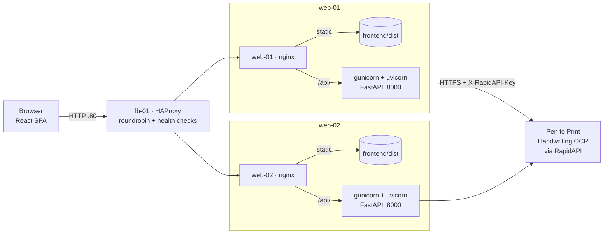

# InkDoc

**Turn photos of handwritten pages into editable text, then export them as Word, PDF, Markdown, HTML or plain text.**

- **Live:** http://34.205.73.55 (HAProxy load balancer in front of two web servers)
- **Demo video:** DEMO_VIDEO_URL
- **Demo script:** [docs/DEMO_SCRIPT.md](docs/DEMO_SCRIPT.md)

---

## The problem and who it's for

Many people still think best with a pen: students taking lecture notes, researchers filling field notebooks, teams sketching in meetings. Sharing those notes means retyping them, which is slow and error-prone. InkDoc removes that step: photograph the pages, fix anything the OCR misread, and download a clean document.

**Users:** students submitting or sharing notes, researchers digitising notebooks, and anyone who wants searchable copies of handwritten pages.

## Features

- **Upload up to 10 pages** by drag and drop, file picker or phone camera, then reorder and remove pages before extracting.
- **Client- and server-side validation:** type and 10 MB size checks in the browser; the server decodes every upload with Pillow, so a renamed file can't pass as an image.
- **Per-page progress:** each page shows queued, reading, done or failed. Partial failures keep the pages that worked.
- **Editor**
  - Per-page view (original photo beside its text) or a combined view
  - Word, character and reading-time counts
  - Find & replace with a match count and case toggle
  - Cleanup tools: trim spaces, join broken lines (and re-join hyphenated words), sentence case, UPPER and lower case, with undo
  - Autosave, renaming and copy to clipboard
  - "Served by web-0X" and "Cached" badges
- **Export** to DOCX, PDF (Unicode-safe), TXT, MD or HTML, with font size, optional date and page-break options.
- **History** kept in the browser:
  - Search across titles and text, with highlighted matches
  - Filters by date range and export format
  - Sorting by newest, oldest, A–Z, or most/fewest words
  - A stats strip, plus open, rename, delete and clear all (all with confirmation dialogs)
- **Designed UI, "ink on paper":** an editorial notebook look with ruled sheets, serif type for documents, mono metadata and one vermilion accent.
  - Light and dark mode (persisted), responsive down to 360 px
  - Keyboard accessible with a skip link and visible focus rings
  - `aria-live` status messages, skeleton loading states, toasts and empty states

## Screenshots

| Home | Editor | History |
| --- | --- | --- |
|  |  |  |


## Architecture



Each web server serves the built frontend and the API on the same origin, so production needs no CORS. The API key exists only in `/opt/inkdoc/backend/.env` on the web servers.

```
inkdoc/
├── backend/            FastAPI app
│   ├── app/
│   │   ├── main.py         app factory, CORS, routers, lifespan (shared httpx client)
│   │   ├── config.py       settings from env / .env (pydantic-settings)
│   │   ├── errors.py       domain errors → {"error": {code, message}}
│   │   ├── routes/         health, ocr, export
│   │   ├── services/       ocr_client (retry + error mapping), image (Pillow), cache (TTL)
│   │   ├── exporters/      registry + docx, pdf, text (txt/md/html)
│   │   └── assets/         DejaVuSans.ttf for Unicode PDFs
│   └── tests/          pytest + respx (upstream API mocked)
├── frontend/           React + Vite + TypeScript + Tailwind v4
│   └── src/{components,pages,lib,hooks}
├── deploy/             nginx.conf, haproxy.cfg, inkdoc.service, provision + deploy scripts
└── .github/workflows/ci.yml
```

## Run it locally

**Prerequisites:** Python 3.11+, Node 20.19+, and a RapidAPI key subscribed to Pen to Print.

```bash
# Backend (http://localhost:8000, interactive docs at /api/docs)
cd backend
python3 -m venv .venv && source .venv/bin/activate
pip install -r requirements-dev.txt
cp ../.env.example .env        # then set RAPIDAPI_KEY in backend/.env
uvicorn app.main:app --reload

# Frontend (http://localhost:5173), in a second terminal
cd frontend
npm install
npm run dev
```

In development the frontend calls `http://localhost:8000` directly, and the API allows that origin via CORS. Production builds use relative `/api` URLs.

## Environment variables

Set in `backend/.env` (never committed; `.gitignore` excludes every `.env*` except `.env.example`).

| Variable | Default | Purpose |
| --- | --- | --- |
| `RAPIDAPI_KEY` | _(empty)_ | Pen to Print key. Empty means `/api/ocr` returns 503 "OCR service not configured". |
| `RAPIDAPI_HOST` | `pen-to-print-handwriting-ocr.p.rapidapi.com` | Upstream host |
| `OCR_TIMEOUT` | `30` | Seconds per upstream attempt |
| `CACHE_TTL` | `86400` | Seconds an OCR result stays cached |
| `RATE_LIMIT` | `30/15 minutes` | Per-client limit on `/api/ocr` |
| `TRUSTED_PROXY_HOPS` | `2` | Proxies that append to `X-Forwarded-For` (HAProxy, nginx) |
| `CORS_ORIGINS` | `["http://localhost:5173"]` | Allowed browser origins (dev only) |

## API

### External API: Pen to Print Handwriting OCR

- **Endpoint:** `POST https://pen-to-print-handwriting-ocr.p.rapidapi.com/recognize/`
- **Docs:** https://rapidapi.com/serendi/api/pen-to-print-handwriting-ocr
- **Request:** `multipart/form-data` with the image in `srcImg` and `Session=string`. The headers are `X-RapidAPI-Key` and `X-RapidAPI-Host`.
- **Response:** the text is in `value` (InkDoc falls back to `result`). An empty string means no text was detected.
- **Quotas:** set by your RapidAPI plan (see the API's _Pricing_ tab). When the quota runs out, RapidAPI returns 429, which InkDoc shows as "Daily OCR limit reached".
- **Key handling:**
  - The key is read on the server only and stored as a `SecretStr`, so it never appears in reprs or logs.
  - It is sent only in the upstream request header.
  - It never appears in the frontend bundle, in API responses, in git or in this README.
  - On servers it lives in `/opt/inkdoc/backend/.env`, owned by the `inkdoc` service user with mode `600`.

### InkDoc's own endpoints

| Method | Path | Description |
| --- | --- | --- |
| GET | `/api/health` | `{status, server, ocr_configured, version}` |
| POST | `/api/ocr` | Form field `images` (1–10 files, ≤10 MB each). Returns `{pages: [{index, filename, text, words, cached, error?}], server}` |
| POST | `/api/export` | JSON `{title ≤120, text ≤200k, format: docx\|pdf\|txt\|md\|html, options: {font_size, include_date, page_breaks}}`. Returns the file with a safe `Content-Disposition`. Pages are separated by a form feed (`\f`). |
| GET | `/api/docs` | Interactive OpenAPI docs |

**OCR pipeline:**

1. Validate every upload: size, then a full Pillow decode.
2. Preprocess: apply EXIF rotation, convert to greyscale, autocontrast, cap the longest side at 2000 px, re-encode as JPEG.
3. Compute the SHA-256 of the processed bytes and look it up in the 24 h TTL cache.
4. Call the API page by page, with a 30 s timeout and one retry on 5xx, timeout or network error.

## Deployment

Three Ubuntu 20.04 servers: `web-01` 35.175.138.189, `web-02` 34.201.249.145 and `lb-01` 34.205.73.55. All deploy scripts run from your machine over SSH, are idempotent, back up existing configs, and validate configs before reloading.

```bash
export SSH_KEY=~/.ssh/your_key
deploy/provision_web.sh backend/.env       # once (or to rotate the key)
HAPROXY_STATS_USER=admin HAPROXY_STATS_PASS='…' deploy/provision_lb.sh
deploy/deploy.sh                           # every release
```

### 1. Web servers: `deploy/provision_web.sh`

- Installs nginx, rsync and curl.
- Installs a pinned [uv](https://docs.astral.sh/uv/) and uses it to install a standalone **Python 3.12** into `/opt/python`, because Ubuntu 20.04 only ships Python 3.8.
- Creates a locked-down `inkdoc` system user and `/opt/inkdoc/{backend,frontend}`, plus a virtualenv.
- Copies your `.env` to `/opt/inkdoc/backend/.env` (`chmod 600`, owner `inkdoc`) and shreds the temporary copy.
- Backs up `/etc/nginx` to `/root/nginx-backup-<timestamp>.tgz`, installs the site, runs `nginx -t`, then reloads.

**`deploy/inkdoc.service`** (systemd):

- Runs `gunicorn app.main:app --worker-class uvicorn_worker.UvicornWorker --workers 1 --bind 127.0.0.1:8000 --timeout 180` as `inkdoc`.
- Sets `Restart=on-failure` and sandboxing (`ProtectSystem=strict`, `ProtectHome`, `PrivateTmp`, `NoNewPrivileges`).
- Binds to 127.0.0.1, so the API is reachable only through nginx.
- Uses one async worker, so the OCR cache and rate limiter are consistent within each server.

**`deploy/nginx.conf`:**

| Directive | Why |
| --- | --- |
| `root /opt/inkdoc/frontend/dist` + `try_files $uri $uri/ /index.html` | Serves the SPA; deep links like `/history` fall back to `index.html` |
| `location /api/ { proxy_pass http://127.0.0.1:8000; … }` | Forwards API calls to gunicorn with `X-Forwarded-For` appended |
| `client_max_body_size 110M` | Allows 10 images × 10 MB plus multipart overhead |
| `proxy_read_timeout 180s` | 10 pages × (30 s + retry) can take minutes |
| `gzip on` + `gzip_types …` | Compresses JS, CSS, JSON and text (the JS bundle drops from ~318 KB to ~117 KB) |
| `location /assets/ { expires 1y; }` | Vite fingerprints these filenames, so they can be cached for a year |
| `location / { expires -1; }` | `index.html` is always revalidated, so new releases show up immediately |
| `add_header X-Served-By $hostname always` | Shows which server answered (also `nosniff` and `Referrer-Policy`) |

### 2. Load balancer: `deploy/provision_lb.sh` and `deploy/haproxy.cfg`

- `frontend inkdoc_http` binds `:80`; `backend inkdoc_web` uses **`balance roundrobin`** across both web servers.
- **`option httpchk GET /api/health`** with `http-check expect status 200` and **`check inter 5s fall 3 rise 2`**:
  - A server is removed after 3 failed checks (about 15 s).
  - It is re-added after 2 passing checks.
  - The check exercises nginx and the app, not just the TCP port.
- **`option forwardfor`** adds the client IP. nginx appends HAProxy's IP, and the app takes the entry `TRUSTED_PROXY_HOPS` (2) positions from the right. A client can't spoof its rate-limit identity by sending its own `X-Forwarded-For`.
- **`timeout server 180s`** matches nginx's proxy timeout.
- **Stats page:**
  - Served on `:8404` behind basic auth.
  - The credentials come from `HAPROXY_STATS_USER` and `HAPROXY_STATS_PASS` at provision time and are rendered into the config, so they never touch the repo.
  - The script backs up the old config, validates the new one with `haproxy -c`, then reloads.

### 3. Rolling deploy: `deploy/deploy.sh`

1. Builds the frontend once locally (`npm ci && npm run build`).
2. On **web-01**: rsyncs `backend/` (excluding `.env`, `.venv` and tests) and `frontend/dist/`, runs `pip install -r requirements.txt`, then `systemctl restart inkdoc`.
3. Polls `http://web-01/api/health` until it returns **200**. If it never does, the deploy stops and web-02 is left untouched.
4. Repeats for **web-02**.

HAProxy routes around the server being restarted, so the site stays up throughout.

## Testing the load balancer

The output below is real, captured from the live deployment.

```text
$ curl -sI http://35.175.138.189/ | grep -iE '^HTTP|x-served-by'
HTTP/1.1 200 OK
X-Served-By: 7107-web-01
$ curl -sI http://34.201.249.145/ | grep -iE '^HTTP|x-served-by'
HTTP/1.1 200 OK
X-Served-By: 7107-web-02

$ for i in $(seq 10); do curl -s http://34.205.73.55/api/health | grep -o '"server":"[^"]*"'; done
"server":"7107-web-02"
"server":"7107-web-01"
"server":"7107-web-02"
"server":"7107-web-01"
"server":"7107-web-02"
"server":"7107-web-01"
"server":"7107-web-02"
"server":"7107-web-01"
"server":"7107-web-02"
"server":"7107-web-01"

# Failover: stop the app on web-01
$ ssh ubuntu@35.175.138.189 'sudo systemctl stop inkdoc'; sleep 20
$ for i in $(seq 6); do curl -s http://34.205.73.55/api/health | grep -o '"server":"[^"]*"'; done
"server":"7107-web-02"   (×6, all HTTP 200)
$ ssh ubuntu@35.175.138.189 'sudo systemctl start inkdoc'; sleep 15
$ for i in $(seq 4); do curl -s http://34.205.73.55/api/health | grep -o '"server":"[^"]*"'; done
"server":"7107-web-02"
"server":"7107-web-01"
"server":"7107-web-02"
"server":"7107-web-01"
```

In the app, the editor's **"Served by web-0X"** badge and the footer's API status show the same switching.

## Error handling

Every error response has the shape `{"error": {"code", "message"}}`. Upstream response bodies and the API key are never passed through. The frontend turns each code into a plain-language toast with a next step.

| Situation | HTTP | `code` | What the user sees |
| --- | --- | --- | --- |
| Not an image, empty, wrong count, invalid export input | 400 | `bad_request` | The specific problem + "Check the file or input and try again." |
| Image larger than 10 MB | 413 | `payload_too_large` | "… is larger than 10 MB." + "Use images under 10 MB each." |
| Key missing, or rejected by RapidAPI (401/403) | 503 | `ocr_not_configured` | "Text recognition isn't set up on the server." |
| RapidAPI quota exhausted (429) | 429 | `ocr_quota_exceeded` | "The daily OCR limit has been reached." + "Try again tomorrow…" |
| InkDoc rate limit (30 / 15 min / IP) | 429 | `rate_limited` | "You're sending pages too quickly." + "Wait a few minutes…" |
| Upstream 5xx or network error (after 1 retry) | 502 | `ocr_unavailable` | "The OCR service is temporarily unavailable." |
| Upstream timeout (after 1 retry) | 504 | `ocr_timeout` | "The OCR service took too long to respond." |
| Some pages fail | 200 | per-page `error` | Successful pages are kept, and a toast lists how many failed |
| Server unreachable | – | `network` | "Can't reach the InkDoc server." + "Check your connection…" |

If a quota, key or rate-limit error occurs, InkDoc stops calling the API for the remaining pages instead of burning more requests.

## Security

- The API key is server-only (`SecretStr`, `.env` with mode `600` owned by a no-login service user) and is never logged, returned or bundled.
- Uploads are checked for size, then fully decoded by Pillow from an allow-list of formats (JPEG, PNG, WEBP, BMP, TIFF, GIF). Decompression bombs are rejected.
- OCR text is rendered only through React text nodes (no `dangerouslySetInnerHTML`). HTML exports escape all user text, and History search highlighting is built from React elements, not HTML strings.
- Export filenames are sanitised, with an ASCII `filename` plus an RFC 5987 `filename*`. Control characters are stripped from export input.
- `/api/ocr` is rate limited per client IP, using a spoof-resistant read of `X-Forwarded-For`.
- In production, gunicorn listens on 127.0.0.1 only, under systemd sandboxing. HAProxy stats are behind basic auth, with credentials kept out of git.

## Performance

- **Preprocessing:**
  - Greyscale, autocontrast and resizing to at most 2000 px shrink uploads, typically from several MB to a few hundred KB.
  - This makes upstream calls faster and improves recognition of faint pen strokes.
  - Pillow work runs in a thread pool so the event loop stays responsive.
- **Caching:**
  - Results are keyed by the SHA-256 of the processed image and kept in a 24 h TTL cache, so re-uploading the same page costs no API call (shown as a "Cached" badge).
  - The cache lives in memory on each server.
- **Connection reuse:** one shared async `httpx` client per process.
- **Frontend delivery:** gzip, year-long immutable caching for fingerprinted assets, and a single ~117 KB gzipped JS bundle.

## CI

`.github/workflows/ci.yml` runs on every push and pull request:

- **Backend (Python 3.12):** `ruff check`, `ruff format --check` and `pytest` (40 tests; the Pen to Print API is mocked with respx).
- **Frontend (Node 22):** `npm ci`, `tsc --noEmit` and `vite build`.

Run the same checks locally:

```bash
cd backend && ruff check . && pytest
cd frontend && npm run typecheck && npm run build
```

## Challenges

> **TODO (author):** describe the challenges you faced and how you solved them.

## Credits

- **[Pen to Print – Handwriting OCR](https://rapidapi.com/serendi/api/pen-to-print-handwriting-ocr)** by **Serendi**, the handwriting recognition engine
- **[RapidAPI](https://rapidapi.com)**, the API marketplace and gateway
- Backend: [FastAPI](https://fastapi.tiangolo.com), [Uvicorn](https://www.uvicorn.org), [uvicorn-worker](https://github.com/Kludex/uvicorn-worker), [Gunicorn](https://gunicorn.org), [HTTPX](https://www.python-httpx.org), [Pillow](https://python-pillow.org), [python-docx](https://python-docx.readthedocs.io), [fpdf2](https://py-pdf.github.io/fpdf2/), [pydantic-settings](https://docs.pydantic.dev/latest/concepts/pydantic_settings/), [cachetools](https://github.com/tkem/cachetools), [SlowAPI](https://github.com/laurentS/slowapi), [python-multipart](https://github.com/Kludex/python-multipart)
- Testing and tooling: [pytest](https://pytest.org), [RESPX](https://lundberg.github.io/respx/), [Ruff](https://docs.astral.sh/ruff/), [uv](https://docs.astral.sh/uv/)
- Frontend: [React](https://react.dev), [Vite](https://vite.dev), [TypeScript](https://www.typescriptlang.org), [Tailwind CSS](https://tailwindcss.com), [React Router](https://reactrouter.com), [Lucide](https://lucide.dev)
- Infrastructure: [nginx](https://nginx.org), [HAProxy](https://www.haproxy.org)
- Type: [Fraunces](https://fonts.google.com/specimen/Fraunces), [IBM Plex Sans and Mono](https://www.ibm.com/plex/) and [Caveat](https://fonts.google.com/specimen/Caveat), self-hosted via [Fontsource](https://fontsource.org); [DejaVu Sans](https://dejavu-fonts.github.io) for PDFs (license in `backend/app/assets/DejaVuSans-LICENSE.txt`)

## License

[MIT](LICENSE)
